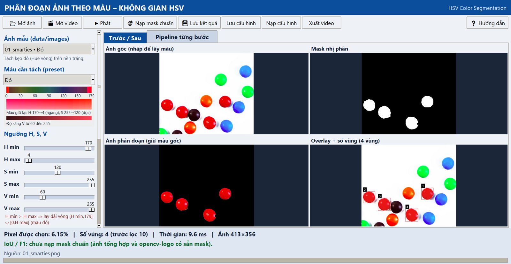
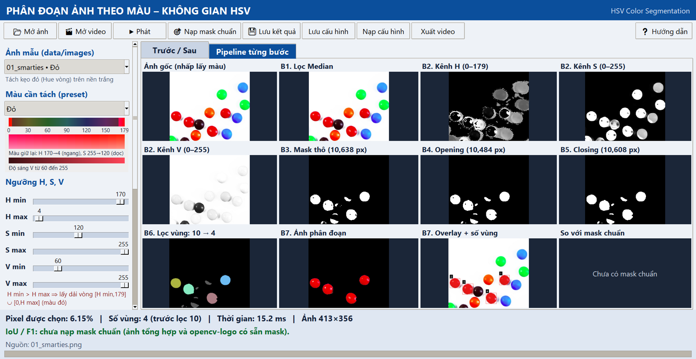

# HSV Color Segmentation

[](https://github.com/DucTri5405/hsv-color-segmentation/actions/workflows/tests.yml)

Ứng dụng desktop phân đoạn ảnh theo màu trên không gian HSV, viết bằng Python, OpenCV và Tkinter.
Chọn màu cần tách, chỉnh ngưỡng H, S, V bằng thanh trượt và xem ngay kết quả từng bước: mask, ảnh phân đoạn,
số vùng và các chỉ số đánh giá.



## Tính năng

- Mở ảnh, ảnh mẫu có sẵn hoặc video (phát và xuất video AVI đã phân đoạn).
- Preset màu (Đỏ, Cam, Vàng, Xanh lá, Xanh dương, Tím...) và 6 thanh trượt H, S, V; tự xử lý màu đỏ nằm ở hai đầu vòng Hue.
- Hậu xử lý: lọc Median, Opening, Closing, lọc vùng nhỏ, đếm và đánh số vùng; tùy chọn lấp khuyết viền
  (bao lồi từng vùng) cho vật tròn bị vệt phản sáng ở mép.
- Tab *Trước / Sau* và tab *Pipeline từng bước*.
- Nhấp vào ảnh để xem giá trị HSV và gợi ý ngưỡng; tách nhiều màu cùng lúc.
- Nạp mask chuẩn để tính IoU, Precision, Recall, F1.
- Lưu kết quả (ảnh từng bước, `config.json`, `stats.json`, `components.csv`), lưu và nạp cấu hình.



## Cài đặt và chạy

Cần Python 3.10 trở lên.

```bash
python -m pip install -r requirements.txt
```

```bash
python main.py
```

Trên Windows có thể nhấp đôi `run_app.cmd`. Một số tùy chọn:

```bash
python main.py --sample 02_peppers
```

```bash
python main.py --video data/videos/smarties_chuyen_dong.avi
```

Đóng gói thành file `.exe` chạy không cần Python: chạy `build_exe.cmd` (PyInstaller), kết quả ở `dist/HSV_Segmentation/`.

## Thuật toán

```
BGR → Median → BGR→HSV → inRange (H, S, V) → Opening → Closing → lọc vùng nhỏ + đếm → bitwise_and
```

- Màu đỏ có Hue nằm ở hai đầu thang 0–179, nên khi `H_min > H_max` chương trình lấy hai dải
  `[H_min, 179]` và `[0, H_max]` rồi ghép bằng `bitwise_or`.
- S loại nền trắng/xám (độ bão hòa thấp), V loại vùng quá tối.
- Đỏ và cam nằm sát nhau trên thang Hue (kẹo cam đo được H 0–17, kẹo đỏ H 171–179 và 0), nên preset Đỏ (170–5)
  và Cam (6–22) không chồng nhau, và mỗi ảnh mẫu có ngưỡng chỉnh riêng trong `config/`.
- `bgr_to_hsv_manual` cài lại công thức chuyển HSV bằng NumPy để đối chiếu với OpenCV (sai khác ≤ 1).

Mã nguồn chính nằm trong `hsv_app/core.py`.

## Đánh giá

```bash
python evaluate.py
```

Chạy trên toàn bộ dữ liệu và ghi bảng số liệu, ảnh kết quả vào `outputs/`. Kết quả trung bình trên 6 ảnh tổng hợp có mask chuẩn:

| Cấu hình | IoU |
|---|---|
| Chỉ ngưỡng HSV | 0,917 |
| + Opening/Closing | 0,953 |
| + Median trước | 0,998 |

Với màu đỏ, dùng một dải Hue chỉ đạt IoU 0,585; ghép hai dải đạt 1,000.

## Kiểm thử

```bash
python -m pytest -q
```

## Dữ liệu

16 ảnh thật (ảnh mẫu của OpenCV, scikit-image và ảnh peppers), 6 ảnh tổng hợp có mask chuẩn và 1 video.
Nguồn và giấy phép từng ảnh: [data/NGUON_DU_LIEU.md](data/NGUON_DU_LIEU.md).

## Cấu trúc

```
hsv_app/    core.py (thuật toán), gui.py, io_utils.py, video.py, samples.py
config/     cấu hình ngưỡng cho từng ảnh mẫu (JSON)
data/       images/, synthetic/ (ảnh + mask chuẩn), masks/, videos/
tests/      kiểm thử pytest
evaluate.py chạy đánh giá trên toàn bộ dữ liệu
```

## Tác giả

Nguyễn Đức Trí

## Giấy phép

Mã nguồn phát hành theo giấy phép [MIT](LICENSE). Ảnh mẫu trong `data/` giữ giấy phép gốc của từng nguồn,
xem [data/NGUON_DU_LIEU.md](data/NGUON_DU_LIEU.md).
